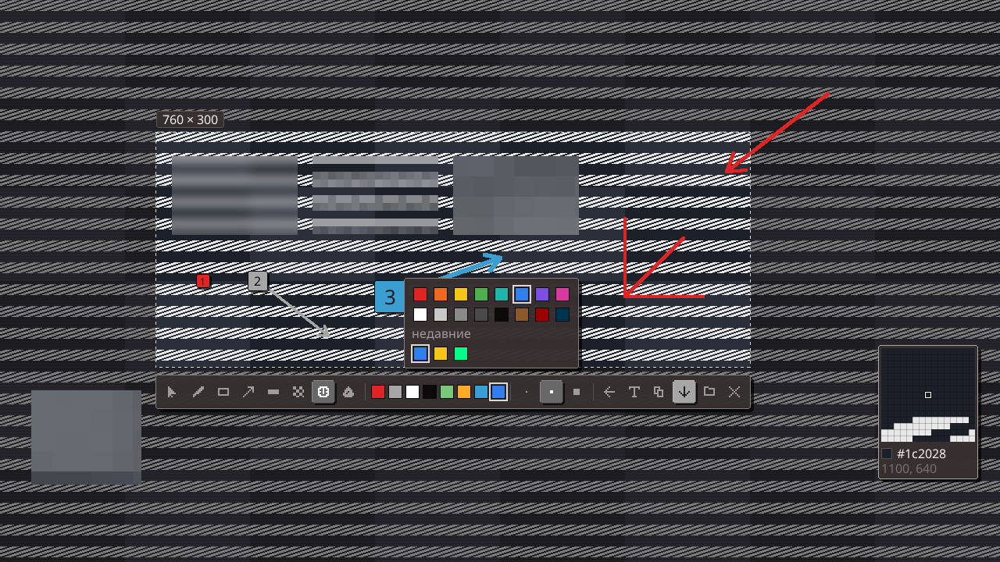

# ysnap

Пиксельная скриншотилка для [niri](https://github.com/YaLTeR/niri). Выросла из скриншотилки шелла
[yami](https://github.com/Trendorin/yami) и работает сама по себе, без шелла.



## Что умеет

- область, окно, весь монитор; рисовать можно и за рамкой, рамку можно двигать и тянуть
- перо (с Shift — прямые через 45°), рамка, стрелка, маркер, номерки со стрелкой, пипетка
- размытие трёх видов: лёгкое, мозаика, крупная мозаика
- палитра с меню «другие цвета» и недавними, лупа у курсора (пробел)
- снимок активного окна с рамкой, скруглением и тенью из конфига niri, на прозрачном фоне
- текст со снимка (tesseract) и QR (zbarimg) в буфер
- цвета и шрифт — из системы (`gtk.css`, `gtk-font-name`), например от Noctalia

## Сборка

```bash
cargo build --release
cp target/release/ysnap ~/.local/bin/
```

Нужен `wl-copy`. Экран снимается сам (wlr-screencopy), `grim` — запасной вариант. По желанию: `notify-send`, `tesseract`, `zbarimg`, `zenity` или `kdialog`.

Без демона: от нажатия до оверлея ~30 мс (снимок через screencopy, niri через сокет, шрифты в фоне и с кешем).

## niri

```kdl
binds {
    Print       { spawn "ysnap"; }            // область с разметкой
    Alt+Shift+2 { spawn "ysnap" "window"; }   // активное окно с рамкой и тенью
    Alt+Shift+3 { spawn "ysnap" "screen"; }   // монитор в фокусе
}
```

## Настройки

`~/.config/ysnap.json` создаётся при первом запуске, с подсказками у каждого ключа:

```json
{
  "save": "both",
  "screenshotPath": "~/Pictures/Screenshot/%d-%m-%y %H-%M-%S.png"
}
```

`save`: `both` — в папку и в буфер, `folder` — только в папку, `clipboard` — только в буфер.
`screenshotPath` — шаблон strftime, как `screenshot-path` у niri.

## Клавиши

Enter — готово · Esc — выйти · пробел — лупа · 1–8 — инструменты · колесо — толщина ·
Ctrl+Z / Ctrl+Shift+Z — отменить / вернуть · Ctrl+C — в буфер · Ctrl+S — сохранить как…

## Лицензия

MIT. Часть кода (`px/`, оверлей, распознавание текста) взята из
[yami](https://github.com/Trendorin/yami), © YAMI contributors.
